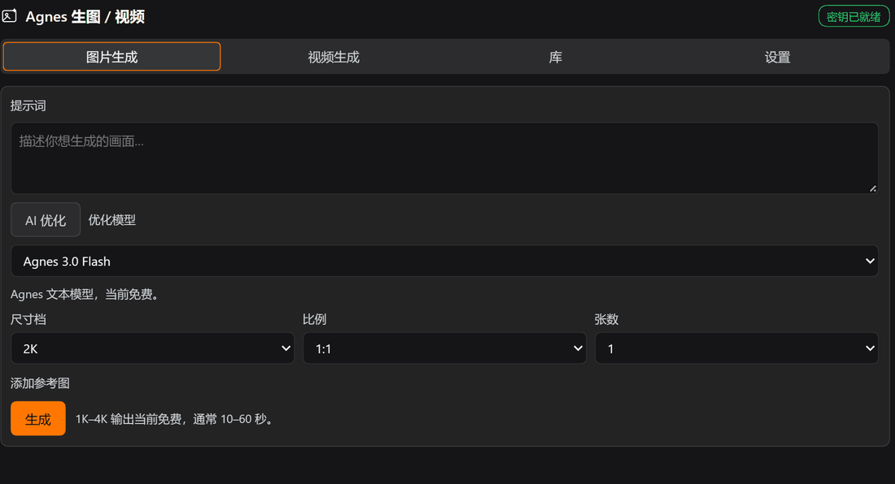

# dsh-agnes-image

**English** · [中文](README_ZH.md)

> **DeepSeek Harness can draw — and now it can move.** 4K stills, 4–12 s 720P video, a one-click prompt optimizer, a library that hands files to your desktop. Video runs on Agnes's free queue (¥0/s today); when the queue is busy the plugin backs off and retries instead of failing.

```bash
npm install dsh-agnes-image
# or
dsh plugin --profile <your profile> add dsh-agnes-image
```



Agnes image and video generation for [DeepSeek Harness](https://github.com/deepseek-harness). It adds two agent tools (`agnes_generate_image`, `agnes_generate_video`), an AI prompt optimizer, and a sidebar panel with four tabs: Images, Videos, Library, Settings. Progress reporting is honest, cards are poster-first, and files are handed off to the desktop.

The plugin ships without an API key. Install it, open the panel's Settings tab, paste your Agnes key once and save. Only then do the generation buttons light up; until then they are disabled and explain why. Credentials live in your own `%DSH_HOME%` data directory, never in this repository.

Both halves are hand-written against the official DSH bundle format. There is no build step: `index.js` is the host half, and `client.js` is the browser bundle.

Agnes APIs used:

| Purpose | Model | Endpoint |
| --- | --- | --- |
| Image generation | `agnes-image-2.5-flash` | `POST https://api.agnes-ai.cn/v1/images/generations` |
| Video generation | `agnes-video-2.5-flash` (default; 720P only) | `POST https://api.agnes-ai.cn/v1/videos`, poll `GET https://api.agnes-ai.cn/agnesapi?video_id=&model_name=` |
| Prompt optimization | `agnes-3.0-flash` | `POST https://api.agnes-ai.cn/v1/chat/completions` |

Docs: [image](https://www.agnes-ai.cn/zh-Hans/docs/agnes-image-25-flash) · [video](https://www.agnes-ai.cn/zh-Hans/docs/agnes-video-25-flash) · [text](https://www.agnes-ai.cn/zh-Hans/docs/agnes-30-flash)

## Screenshots

Real panel in a desktop profile, captured from the running harness.

| Images tab | Videos tab |
| --- | --- |
|  |  |

| Image library | Video library, posters |
| --- | --- |
|  |  |


## Files

| File | Role |
| --- | --- |
| `package.json` | bundle manifest: `dsh.bundle.patch` + `dsh.client` (platform `web`) + `exports["./client"]` |
| `cordis.patch.yml` | bundle patch layer. One `insert` row with `id: agnes-image`, which is also the settings namespace. No credential is written here. |
| `index.js` | host half: Config, key resolution (panel only), Agnes calls, disk output, tool registration, `/api/agnes-image/*` routes (video, video covers, prompt optimize, local file open) |
| `client.js` | browser half: `sidebar.panellist` icon plus the whole `main` page (Images / Videos / Library / Settings) |
| `icon.svg` | sidebar icon |

## Documentation

Longer notes live in `docs/`:

- [Index](docs/index.en.md)
- [Install](docs/install.en.md) · [Usage](docs/usage.en.md) · [Configuration](docs/configuration.en.md) · [Architecture](docs/architecture.en.md) · [Contributing](docs/contributing.en.md)
- 中文版：[docs/index.md](docs/index.md) · [README_ZH.md](README_ZH.md)

## Capabilities

### 1. Agent tool `agnes_generate_image`

Call it straight from a conversation.

Parameters: `prompt` (required), `size` (`1K`/`2K`/`3K`/`4K`), `ratio` (`1:1`, `3:4`, `4:3`, `16:9`, `9:16`, `2:3`, `3:2`, `21:9`), `count` (1–4), `reference_images` (image-to-image or composition: a public HTTPS URL or a `data:image/...;base64` string).

It returns absolute paths on disk, for example:

```
Agnes generated 1 image (agnes-image-2.5-flash, 2K 1:1).
Saved to disk — absolute paths:
  C:\...\default-workspace\agnes-images\2026-10-16\190212-测试：一只戴宇航头盔的柴犬.png  (836.9 KB)
```

### 2. Agent tool `agnes_generate_video`

This one blocks: create task, poll, download. The default ceiling is 15 minutes.

Parameters: `prompt` (required), `mode` (`text` / `keyframe` / `reference`), `seconds` (`"4"`–`"12"`, default `"5"`), `size` (`720P`; with `agnes-video-2.5` also `1080P`/`1K`/`2K`), `aspect_ratio` (`16:9`/`9:16`/`1:1`/`4:3`/`3:4`/`21:9`), `first_frame` / `last_frame` (keyframe mode), `images[]` / `audios[]` (reference mode), `seed`.

Agnes enforces the per-mode media rules, and this plugin validates them locally before the request, then re-throws the upstream error verbatim. `text` carries no media. `keyframe` needs at least one frame and no images or audios. `reference` needs at least one image or audio clip and no first or last frame. In `reference` mode local file paths are inlined into `data:` URLs automatically: single file under 15 MB, edge length 256–5760 px, and anything outside that errors. Public HTTPS URLs are accepted too.

### 3. AI prompt optimizer

Both prompt boxes, image and video, have an AI Optimize button. It hands the current prompt to a language model and shows a rewrite card first. The card holds only the rewritten prompt, expanded in place right under the prompt box and above the button. The original stays in the input above, the card does not repeat it, and it has no card title. Adopt writes it back, Discard throws it away, Retry asks again. The rewrite keeps subject and intent and only adds visual detail: composition, light, palette, material, mood, style. It follows the input language. The video side additionally asks for motion, camera movement and pacing.

Two backends, picked from a dropdown and persisted to settings:

| Backend | Behavior |
| --- | --- |
| `agnes` (default) | `agnes-3.0-flash` via Agnes Chat Completions, same key as generation |
| `dsh` | Reuses the harness' current conversation model (`agentDefaultModel.currentSelection()`). If the host has no LLM service or the profile has no model configured, the option shows as unavailable and nothing else is affected |

### 4. Sidebar panel

Four tabs, left to right: Images, Videos, Library, Settings. The panel shares the same host code path as the tools, so behavior is identical.

- Images: prompt, size, ratio, count, optional reference images. Thumbnails appear immediately.
- Videos: prompt, mode, seconds, aspect ratio, resolution. Keyframe mode reveals first/last frame inputs, reference mode reveals image and audio rows. After submit the button area shows queue and render progress and polls automatically. On completion it never plays in the panel; it shows a poster plus "Open with default app". History is not on this tab. Everything is collected in the Library.
- Progress bar: a running image job shows an indeterminate striped bar plus elapsed seconds. Image generation is a single call with no percentage, so no number is invented. A running video job shows the real upstream percentage (0/10/70/100), plus status and elapsed seconds, for example `Rendering: in_progress · 10% · 84s elapsed`. When the upstream percentage has not moved for more than 12 seconds, which is very common because the 10% step alone can sit for two minutes, the bar switches from a fill to flowing stripes and the caption becomes `Upstream still reports 10% — rendering · 132s elapsed`. It says where the number comes from instead of faking motion or inventing digits, and snaps back to a real fill the moment upstream jumps to 70 or 100. The bar occupies the slot where the old status card was.
- Library: a segmented switch at the top toggles Image library and Video library. Each has its own count and refresh button. Both render as small card grids, about 116 px per image column and 182 px per video column. Videos show a poster only and never play here.
- Cards carry a thumbnail by default. Collapsed, a card shows a thumbnail on top and the file name below, 96×96 for images and 160×90 for video posters. Clicking the file name or the chevron expands the card to reveal the prompt, size, ratio, duration, bytes and the action buttons. Hovering the thumbnail scales it slightly, 1.03×, and draws an orange ring as a hint that it can be double-clicked.
- Opening local files: double-click the thumbnail or poster, or use "Open with default app" in the expanded area. The file goes to the desktop's default association, images to the image viewer and videos to the default player, which is semantically the same as double-clicking in Explorer. "Reveal in folder" selects the file instead. The expand button and the file name only toggle expansion; they never open files.
- Settings: API key (saved into the plugin data directory), model, default size and ratio, video and optimizer defaults, output directory. No key ships with the plugin. Without a key the image, video and optimize (agnes backend) buttons are disabled and a hint appears at the top of Settings.
- Action buttons. Per image: Insert into composer, copy path, open with default app, reveal in folder, delete. Per video: Insert link, copy path, open with default app, reveal in folder, delete.

Output layout:

- Images `<workspace>/agnes-images/<YYYY-MM-DD>/<HHMMSS>-<prompt slug>.<ext>`
- Videos `<workspace>/agnes-videos/<YYYY-MM-DD>/<HHMMSS>-<prompt slug>.mp4`
- Video poster `<same dir>/<same stem>-cover.png`, produced by the panel's frame grab

Repeated names within the same second get `-2`, `-3`. CJK prompts are preserved as-is.

## Video posters: browser frame grab, no ffmpeg

Video cards must show something even when collapsed, but the plugin does not decode video on the host. The author's machine has no ffmpeg, and the core packages expose no host-side thumbnail service, so the frame grab happens in the browser:

1. When a video task completes, on the poll that first yields `file`, the panel builds a hidden `<video>` in `grabFrame()`, waits for `loadeddata`, seeks to `min(0.2s, duration/2)`, and on `seeked` runs `canvas.drawImage()` plus `toDataURL('image/png')`. Max width 640 px, 8-second timeout, and any failure resolves to an empty string.
2. The frame is posted to `POST /api/agnes-image/video-cover` as `{ file, dataUrl }`. The host writes `<same stem>-cover.png` next to the video and records `cover` back into `video-history.json` and, for a matching `file`, into `video-tasks.json`.
3. Cards prefer `record.cover` as an ``. Without a poster they fall back to the first frame of a `<video preload="metadata" muted playsinline>`, with no controls and never playing. If even that fails they show "No cover yet (double-click to open with the default player)".

A failed grab only logs `console.warn('[agnes-image] cover capture failed:')`. A missing poster never blocks anything. Refreshing the Library also back-fills at most 3 old records without a poster, each path attempted once and deduplicated with `useRef(new Set())`.

`video-cover` reuses the same safety boundary as `/open`: only a `file` recorded in `video-history.json` is accepted, otherwise 404 `no history record for that file`. The `dataUrl` must start with `data:image/png;base64,`, be non-empty, and be at most 6 MB.

## Interaction & motion

All of it is CSS, and everything degrades to no animation when the OS asks for reduced motion (`@media (prefers-reduced-motion:reduce)`):

| Where | Effect | How |
| --- | --- | --- |
| Tab switch (Images / Videos / Library / Settings) | 450 ms horizontal slide, 40 px, decelerating `cubic-bezier(.16,1,.3,1)` | The tab body remounts on a keyed wrapper and replays `.dsh-agnes-slide` / `@keyframes dsh-agnes-slide-in`. Direction follows tab order: moving forward (Library → Videos) enters from the right, moving back from the left. The left variant only changes `animation-name` via `.is-left`; duration and curve are shared. |
| Active-tab "top" ring | An orange inset-ring pill slides to the active tab in step with the body | `.dsh-agnes-pill` with `transition: transform 450ms cubic-bezier(.16,1,.3,1)`. Width and offset are computed with `calc()` from the equal-width tab columns (`translateX(calc(<i>*100% + <i>*gap))`). No DOM measurement and no ResizeObserver, so it stays aligned when the sidebar is resized. |
| Library segmented switch | Same feel: body slides, pill slides | The key includes `libraryKind`, so direction follows the switch. It reuses the same `pillStyle()`. |
| Card expand / collapse | 200 ms true-height transition | The expanded area stays in the DOM, so its height is stable. The wrapper toggles `.dsh-agnes-expand{grid-template-rows:0fr}` against `.is-open{grid-template-rows:1fr}`, with `overflow:hidden;min-height:0` on the child. No height measurement and no extra layout pass. |
| Thumbnail / poster hover | 1.03× scale and a 2 px orange ring | `.dsh-agnes-media:hover`. Under reduced motion only the transition is disabled; the affordance stays. |
| Indeterminate progress | Flowing stripes | `.dsh-agnes-bar.is-indeterminate>i` plus `@keyframes dsh-agnes-bar-slide`. Under reduced motion it is a static translucent bar. |

Horizontal overflow from the slide is clipped at the panel root with `overflow-x:hidden`, otherwise a horizontal scrollbar appears mid-animation. The pill is already in place on first render, so opening the panel never shows it sliding in from the first tab.

Tab switching only animates `transform`, never `opacity`. The tab body remounts, and starting from `opacity:0` made tall form tabs flash the bare dark panel background for about 100 ms before growing in, which was far more jarring than the animation itself. It is fully opaque from frame one, direction comes from the 40 px offset alone, and there is no gap.

The collapsed expand area stays in the DOM but is neither focusable nor clickable. `CardShell` uses a `ref` + `useEffect` to set `inert` on the container while collapsed and remove it when expanded. That is the DOM API rather than a JSX prop, so React 18 and 19 behave the same.

## Key policy: panel only, no shipped credential

The only source is the key saved in the panel's Settings tab, written to `%DSH_HOME%\agnes-image\settings.json`.

`Config` has no `apiKey` field and there is no environment-variable fallback. The plaintext key row and `apiKeyEnv` that early versions had are gone. `resolveKey()` reads the settings panel only. Without a key, `status.hasKey === false` and `keySource === 'none'`, and every generation or optimize call on the agnes backend fails with:

`No Agnes API key configured: open the panel Settings tab and save one first (the plugin ships without a key).`

The reasoning: plugins get distributed and copied around, so a credential may only ever live in the user's own data directory, never inside plugin source. `status` reports just `keySource` (`panel` / `none`) and a masked `keyHint` holding the first six and last four characters. It never reports the full key.

## Data files

| Path | Contents |
| --- | --- |
| `%DSH_HOME%\agnes-image\settings.json` | configuration saved by the panel |
| `%DSH_HOME%\agnes-image\history.json` | image history (newest first, capped by `historyLimit`) |
| `%DSH_HOME%\agnes-image\video-history.json` | completed video history (newest first) |
| `%DSH_HOME%\agnes-image\video-tasks.json` | video task table (deduplicated by `videoId`, last 100 kept). Polling resumes after a page reload. |

The task table is what makes "close the page and come back" work. The host remembers `baseDir` per `videoId` and downloads the mp4 into the original workspace when it finishes. The download happens exactly once.

## HTTP routes

The panel uses these. Trust fence and cookie auth are automatic.

| Method | Path | Purpose |
| --- | --- | --- |
| GET | `/api/agnes-image/status` | key source (`panel`/`none`), model, defaults, available options, optimizer and LLM availability |
| GET | `/api/agnes-image/history?limit=` | image history |
| POST | `/api/agnes-image/generate` | `{ prompt, size, ratio, count, referenceImages, sessionId, cwd }` |
| POST | `/api/agnes-image/settings` | save configuration (`clearApiKey: true` clears the panel key) |
| POST | `/api/agnes-image/delete` | `{ file }`, only a file recorded in history |
| POST | `/api/agnes-image/open` | `{ file, action: 'default'\|'reveal' }` → open with the OS default association / reveal in folder |
| POST | `/api/agnes-image/video-create` | `{ prompt, mode, seconds, size, aspectRatio, firstFrame, lastFrame, images, audios, seed, sessionId, cwd }` → `{ ok, task }` |
| GET | `/api/agnes-image/video-status?videoId=` | poll once: progress while queued/rendering, download + `file` when done |
| GET | `/api/agnes-image/video-history?limit=` | completed video history |
| POST | `/api/agnes-image/video-delete` | `{ file }`, only a file recorded in history |
| POST | `/api/agnes-image/video-cover` | `{ file, dataUrl }` → store the panel's PNG frame as `<same stem>-cover.png` and record it |
| POST | `/api/agnes-image/optimize` | `{ prompt, kind: 'image'\|'video', backend: 'agnes'\|'dsh', seconds, sessionId }` → `{ ok, original, prompt, backend, model, notes }` |

Routes are registered through `ctx.connection.fetch.register`, so the `/api` prefix gets authentication automatically. Do not switch to `ctx.webServer.register`, which bypasses it.

### `/open` safety boundary

`open` only opens paths recorded in history, meaning the `file` field of `history.json` or `video-history.json`. Anything else returns 404 `no history record for that file`, otherwise the route would be a generic "open any local file" channel for the page. The host also `stat`s the file to confirm it is still there, and first asks `canOpenNativePath()`. A host without a desktop session, meaning headless, answers `this host cannot open local files (<platform>)`. Calls carry a 30-second timeout.

### Pitfall: `requestBody` is required, even on GET routes

`ConnectionFetchRoute.requestBody` is typed `'buffered' | 'streaming'` (`ConnectionRequestBodyMode`), and there is no "absent" member. `createSharedFetchHandler`'s `requestBodyMode` returns it unchanged (`dsh-client-connection/lib/index.js:610-613`). The HTTP bridge, in the same file at `:43-81`, only special-cases `bodyMode === "buffered"`. Every other value takes the streaming branch, which builds a Request with a body via `Readable.toWeb(req)`. That is illegal for GET and HEAD, so `new Request(url, { method: 'GET', body })` throws before any response exists, and the browser only sees 400 with an empty body and no content-type.

So every route here declares `requestBody: 'buffered'`, including the GET routes. `run.mjs` carries regression assertions for this (`requestBody declared …` / `bridge accepts …`), so a route edit cannot silently drop it.

### Video upstream rate limits (measured)

- `POST /v1/videos` frequently answers 429 (`rate_limit_exceeded`) or 503 `video_queue_full` on the free tier. This plugin retries 429/500/502/503/504 with exponential backoff, default `videoQueueRetries: 6` and delay `min(30s, 5s × attempt)`.
- Polling also eats 429s. `GET /agnesapi` interleaves 429s in practice, so polling treats 429/5xx/network errors as retryable, reports `pending` and keeps waiting. It never marks the task failed, otherwise a perfectly healthy render would be reported as broken.
- Three failure envelopes exist: `{"detail":…}`, `{"code":…,"message":…}` and `{"error":{"message":…}}`. `videoErrorText()` recognizes all three.
- `agnes-video-2.5-flash` supports `"720P"` only. Any other `size` is normalized to `720P` locally; upstream returns a hard 400 `size must be 720P` for flash.
- `id`, `task_id` and `video_id` are the same task string in the create response. Polling uses `video_id`.

### Prompt optimization: two backends and their limits

- The agnes backend uses `POST /v1/chat/completions` with `temperature: 0.7` and `max_tokens` set to Config `optimizeMaxTokens`, default 900. It retries 429/500/502/503/504 up to 3 times at `2000 ms × attempt`, and shares the same envelope parser as image and video.
- The dsh backend uses `ctx.llm.stream({ provider, model, messages, system, maxTokens, sessionId, purpose, signal })`, with provider and model from `ctx.get('agentDefaultModel')?.currentSelection()`, the same usage as the core `dsh-session-title-llm` package. A `BlockAssembler` collects the stream. Only `finish.kind === 'stop'` counts as success; `tool-call` and `max-tokens` are reported as failures.
- `inject` deliberately omits `llm`. A missing LLM service only disables the "DSH current model" optimizer option, and `status.llmAvailable` / `llmRoute` report it honestly, instead of leaving the whole plugin pending and taking image and video generation down with it.
- Input is capped at 4000 characters. Over that you get `prompt is too long to optimize (4000 characters max)`. The output strips ``` fences, `优化结果：`-style prefixes and paired quotes, collapses newlines into one line, and truncates at `OPTIMIZE_MAX_CHARS` (1200).
- Config fields: `optimizeBackend`, `optimizeModel`, `optimizeMaxTokens`, `optimizeTimeoutMs` (default 120 s). Switching backend in the panel writes to `%DSH_HOME%\agnes-image\settings.json`.

### Panel CTA colors

Primary buttons (Generate / Generate video / Save) use a fixed fill of `#ff7700` with dark ink text `#1f1300` for contrast, about 8:1. White on orange is only about 2.7:1. Hover `#e86b00`, active `#d96100` and the `:focus-visible` ring come from a `<style>` injected by `apply()`, with class `.dsh-agnes-primary` and idempotent dedup via `data-plugin-css="dsh-agnes-image/button.css"`, mirroring the core `dsh-client-ui-message-feedback/lib/client.js:12-20` approach. Inline styles cannot express `:hover`. The fill is also written inline so the button stays orange even if injection is blocked. The same stylesheet carries the progress-bar classes `.dsh-agnes-bar`: track `--dsw-alias-bg-layer-2`, fill `#ff7700`, indeterminate state animated by `@keyframes dsh-agnes-bar-slide` and degrading to a static bar under `prefers-reduced-motion`. Everything else uses `--dsw-alias-*` / `--dsw-static-*` theme tokens only.

## Known limitations

- Tool results cannot render as inline image or video cards. The web client only renders image cards for the built-in `read_image`, and third-party `presentResult` is not consumed. Both tools therefore return local paths. To see an image in the chat, send `@<path>` or hand the path to `read_image`. The panel displays thumbnails and posters through the core route `api/file?path=<absolute path>`. Videos only offer "open with default app" when expanded, never in-panel playback.
- "Insert into composer" writes plain text: `` for images and `[name](absolute path)` for videos. DSH exposes no public API to attach media to the composer, so it is text, not an attachment.
- The video tool is blocking. `text` mode takes about 3 minutes and up, with progress sitting at 10 for a long time, and its `timeoutMs` is 900000. The panel uses the non-blocking `video-create` + `video-status` routes, so closing the page does not affect the task; the host resumes from the task table.
- Video reference limits come from upstream. Flash accepts ≤ 5 images and ≤ 3 audio clips, under 15 MB per file. Inlining local files as `data:` URLs also bounds the request body.
- How the browser bundle is picked up, measured: after editing `client.js` the host recomposes the graph and serves a new rev without a restart, so a page refresh or the HMR receiver is enough. An already-loaded host module (`index.js`) cannot be hot-swapped, so host-half changes need a profile restart.
- Every optimize click is a real upstream call. The `agnes` backend shares the key with generation and the free tier occasionally 429s, which the plugin backs off 3 times. The `dsh` backend depends on the host LLM service plus a model configured in the profile.
- `inject` includes `connection`. In a headless profile without a web app the plugin stays pending and the tools are not registered either. For headless use, change `index.js`'s `inject` to `['tools']`.
- "Open local file" hands the path to the desktop session of the host machine. On Windows that is `explorer.exe <file>` through `dsh-native-command`'s `openNativeAssociatedPath`. On a machine without a desktop, over remote sessions or inside a restricted sandbox, the route answers `this host cannot open local files (<platform>)` or the underlying error. The file itself is still on disk and its path can be copied.
- Card expanded and collapsed state lives in page memory only and resets to collapsed on refresh, where collapsed means thumbnail or poster plus file name. Double-clicking the thumbnail means "open", not "expand". The file name and the chevron only toggle expansion.
- A video poster comes from the browser, as described above. The video must have been played once in this browser for a poster to exist. Opening old records on another machine or browser shows only a first frame or the placeholder, never playback, when `<same stem>-cover.png` is missing.
- The Library lists files recorded in this machine's history (`history.json` / `video-history.json`). Deleting a file on disk leaves the entry, and opening it then errors. The card's Delete removes both the record and the file.

## Install

Copy this directory into your DSH profile and register the bundle:

```powershell
$src    = "<this repo>"
$profile = "$env:USERPROFILE\.dsh\profiles\desktop"
Copy-Item $src "$profile\node_modules\dsh-agnes-image" -Recurse -Force
# then add "dsh-agnes-image" to dsh.profile.bundles in $profile\package.json
```

Restart the profile, open the sidebar panel, paste your Agnes API key in Settings and save.

The same package is on npm, so the copy step can be left to npm. It has no dependencies:

```powershell
$profile = "$env:USERPROFILE\.dsh\profiles\desktop"
Push-Location $profile
npm install dsh-agnes-image
Pop-Location
# and still add "dsh-agnes-image" to dsh.profile.bundles in $profile\package.json
```

The plugin manager's `install_bundle` additionally runs `pnpm add` and updates `pnpm-lock.yaml` / `pnpm-workspace.yaml`. The manual install above only does the two steps. One note: a later `pnpm install` inside the profile may prune this unregistered `node_modules` directory. Re-run the copy, or use `pnpm add <absolute path to this repo>` to register it properly.

### Rollback

1. Remove `"dsh-agnes-image"` from `dsh.profile.bundles` in `$profile\package.json`.
2. Delete `$profile\node_modules\dsh-agnes-image`.
3. Restart the profile.

`cordis.patch.yml` inside the plugin directory is only referenced by this bundle's own patch layer, so it becomes inert once the bundle is removed. The profile's own `cordis.patch.yml` is never modified.

## Development verification

The author's harness (`run.mjs`) loads both halves against the real `@deepseek-ai/dsh-tools` + `schemastery` and checks: both tools and all twelve routes registering, the `requestBody` contract and bridge compatibility, Config defaults including video and optimizer plus "Config carries no credential", two real generations written to disk, history, the panel-only key policy (with no key, all three entry points must refuse: status, routes and tools; after saving, `keySource: 'panel'`; after clearing, `none` rather than falling back to Config), settings persistence, the `/open` refusal paths (missing `file` → 400, unrecorded path → 404; the success path is deliberately untested because it would really launch a desktop app), the full `/video-cover` chain (unrecorded → 404, non-PNG data URL → 400, empty frame → 400, and a success path over a fake MP4 plus a planted history row → 200, PNG on disk, `cover` filled in history), delete safety, video parameter validation (mode/media/unknown task), prompt optimization (empty/too long/DSH backend unavailable/real Agnes rewrites for both image and video prompts), the client slot and dictionary contract (zh/en, 99 keys each), and source-level assertions for the motion layer and honest progress (`dsh-agnes-slide` + `dsh-agnes-slide-in-left` + the 450 ms `SLIDE_MS` / `SLIDE_EASE` / `SLIDE_DISTANCE` slide, the `dsh-agnes-pill` + `translateX(calc(` synchronized pill, `dsh-agnes-expand` with `grid-template-rows:0fr` / `.is-open`, the 1.03× `.dsh-agnes-media` hover, `prefers-reduced-motion:reduce`, `VIDEO_STALL_MS` + `progressStamp` + `progress.upstreamStall`, and the absence of any `controls: true`). That last group covers CSS and DOM behavior a headless run cannot execute, so the emitted code is asserted directly.

It also runs without a key. When no key is found, the real-upstream sections (tool calls, panel generation, prompt optimization, and `video-create` payload validation, which resolves the key before validating) are marked `SKIP` and the rest continues. An offline run yields 92 PASS / 0 FAIL with 6 sections skipped, while a run with a key in the panel executes everything and has measured 124 PASS / 0 FAIL / 0 SKIP, including real generation and disk output, delete, poster capture, both prompt rewrites, the 99-key dictionaries and the 8 motion assertions.

Real-upstream calls in the suite (2 generations, 2 optimizations) are wrapped in `retryUpstream()`, which retries only 429/5xx, up to 6 times, 20 s apart. The Agnes free queue fluctuates on a minute scale, and without retries a healthy plugin would be reported broken.

A separate end-to-end smoke run of the video path recorded a 4-second 720P task going `queued` → `pending`(0) → `in_progress`(10) → 70 → `completed`(100) in about 181 seconds, producing a 3.6 MB `ftypisom` MP4, with 429s interleaved during polling. That is exactly why 429 must be retryable during polls.

## License

MIT. See [LICENSE](LICENSE).
