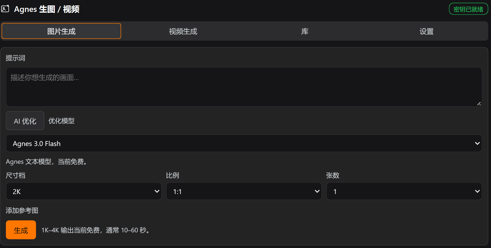
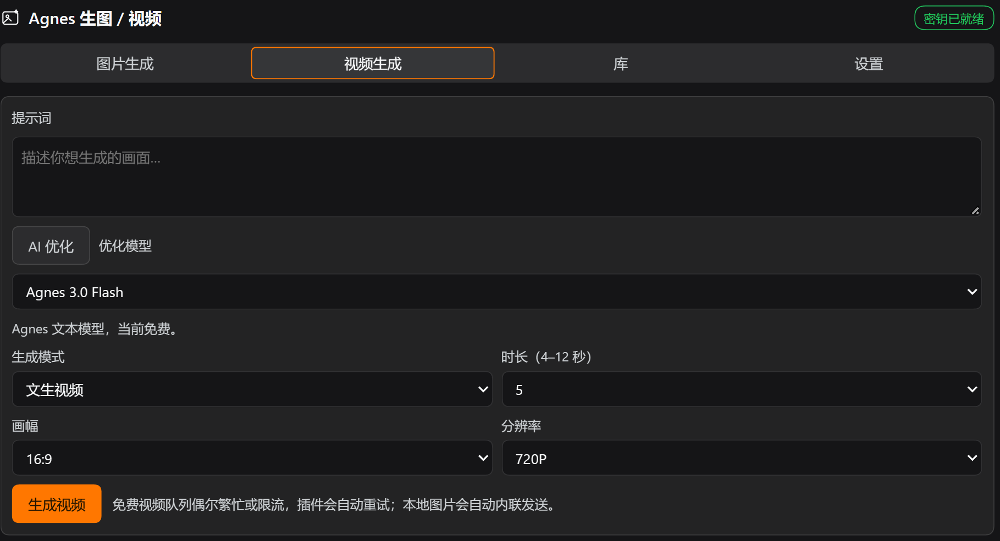
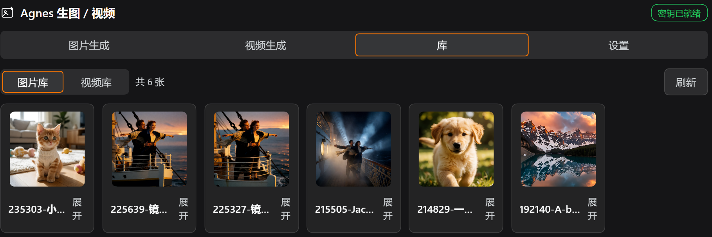
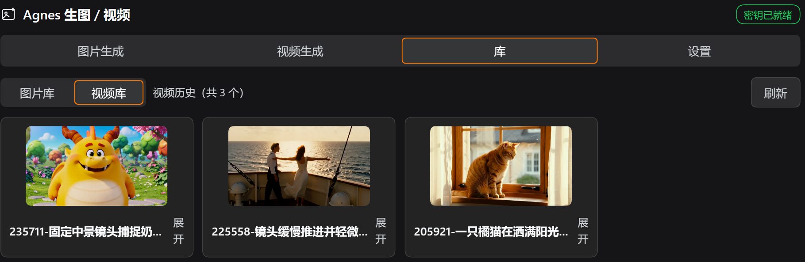
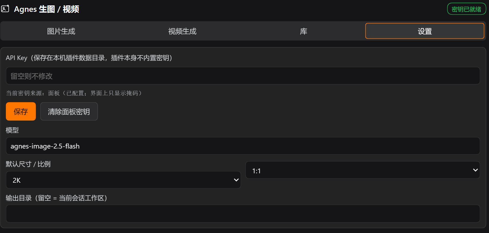

# dsh-agnes-image

[English](README.md) · **中文**

这个插件把 Agnes 的生图与视频生成接进 DeepSeek Harness。装完后你会得到两个原生的 agent 工具，一个侧边栏栏目，以及两个提示词框下方的 AI 优化按钮。

**插件里没有 API key。** 装好后先打开面板「设置」页填一次并保存，生成功能才会启用；没配置时按钮置灰并说明原因。

按 DSH 官方 bundle 格式手写，没有构建步骤：`index.js` 是宿主半，`client.js` 就是浏览器产物。当前版本 `1.4.0`。

用到的三个 Agnes 接口：

| 用途 | 模型 | 端点 |
| --- | --- | --- |
| 生图 | `agnes-image-2.5-flash` | `POST https://api.agnes-ai.cn/v1/images/generations` |
| 视频 | `agnes-video-2.5-flash`（默认，只支持 720P，当前 ¥0/秒） | `POST https://api.agnes-ai.cn/v1/videos`，轮询 `GET https://api.agnes-ai.cn/agnesapi?video_id=&model_name=` |
| 提示词优化 | `agnes-3.0-flash`（当前 ¥0） | `POST https://api.agnes-ai.cn/v1/chat/completions` |

文档：[生图](https://www.agnes-ai.cn/zh-Hans/docs/agnes-image-25-flash) · [视频](https://www.agnes-ai.cn/zh-Hans/docs/agnes-video-25-flash) · [文本](https://www.agnes-ai.cn/zh-Hans/docs/agnes-30-flash)

## 截图

桌面 profile 里跑起来的真实面板。

| 图片生成 | 视频生成 |
| --- | --- |
|  |  |

| 图片库 | 视频库（只看封面） |
| --- | --- |
|  |  |



## 组成

| 文件 | 作用 |
| --- | --- |
| `package.json` | bundle 清单：`dsh.bundle.patch` + `dsh.client`（platform web）+ `exports["./client"]` |
| `cordis.patch.yml` | bundle 补丁层，`insert` 一行 `id: agnes-image`（这个 id 同时是设置命名空间） |
| `index.js` | 宿主半：Config、密钥解析（只认面板）、Agnes 调用、落盘、工具注册、`/api/agnes-image/*` 路由（含视频、视频封面、提示词优化、本地文件打开） |
| `client.js` | 浏览器半：`sidebar.panellist` 图标 + `main` 整页（图片生成 / 视频生成 / 库 / 设置） |
| `icon.svg` | 侧边栏图标 |

## 文档

更细的说明在 `docs/`：

- [索引](docs/index.md)
- [安装](docs/install.md) · [使用](docs/usage.md) · [配置](docs/configuration.md) · [实现](docs/architecture.md) · [参与开发](docs/contributing.md)
- English: [docs/index.en.md](docs/index.en.md) · [README.md](README.md)

## 能力

### 1. agent 工具 `agnes_generate_image`

正常对话里直接调用。

参数：`prompt`（必填）、`size`（1K/2K/3K/4K）、`ratio`（1:1、3:4、4:3、16:9、9:16、2:3、3:2、21:9）、`count`（1–4）、`reference_images`（图生图/合成：公共 HTTPS URL 或 `data:image/...;base64`）。

返回保存后的绝对路径，例如：

```
Agnes generated 1 image (agnes-image-2.5-flash, 2K 1:1).
Saved to disk — absolute paths:
  C:\...\default-workspace\agnes-images\2026-10-16\190212-测试：一只戴宇航头盔的柴犬.png  (836.9 KB)
```

### 2. agent 工具 `agnes_generate_video`

阻塞式：建任务、轮询、下载，默认最长 15 分钟。

参数：`prompt`（必填）、`mode`（`text` / `keyframe` / `reference`）、`seconds`（`"4"`–`"12"`，默认 `"5"`）、`size`（`720P`；换用 `agnes-video-2.5` 时可 `720P`/`1080P`/`1K`/`2K`）、`aspect_ratio`（`16:9`/`9:16`/`1:1`/`4:3`/`3:4`/`21:9`）、`first_frame` / `last_frame`（keyframe 模式）、`images[]` / `audios[]`（reference 模式）、`seed`。

媒体规则由 Agnes 强制。插件在发请求之前先本地校验，错误原样抛出：`text` 不传任何媒体；`keyframe` 至少给一帧，且不传 images/audios；`reference` 至少给一张图或一段音频，且不传首尾帧。`reference` 模式下本地文件路径会自动内联成 `data:` URL，单文件 <15 MB、边长 256–5760 px，超出即报错。也可以直接给公共 HTTPS URL。

### 3. 提示词 AI 优化

生图和视频两个输入框下方都有「AI 优化」。点一下，当前输入框里的提示词就交给一个语言模型改写，先出改写卡。卡片就地展开在提示词框下方、「AI 优化」按钮之下，不等到表单末尾。卡片只显示优化后的提示词，原句仍在上面的输入框里，因此不再重复，也没有卡片标题。

点「采用」才写回输入框；不采用就点「放弃」，不满意可以「重试」。改写取向是保持主体与意图，只补画面细节：构图、光线、配色、材质、氛围、风格，语言跟随输入。视频侧额外要求写清动作、镜头运动与节奏。

两个后端，下拉切换，「优化模型」的选择会持久化到设置：

| 后端 | 说明 |
| --- | --- |
| `agnes`（默认） | `agnes-3.0-flash`，走 Agnes 的 Chat Completions，用同一把 key |
| `dsh` | 复用 DSH 当前对话模型（`agentDefaultModel.currentSelection()` 的 provider/model）。宿主没有 LLM 服务，或 profile 没配模型时，这一项显示为不可用并给出提示，其余功能不受影响 |

### 4. 侧边栏栏目「Agnes 生图 / 视频」

与工具共用同一条宿主代码路径，行为一致。四个页签从左到右：图片生成 / 视频生成 / 库 / 设置。

**图片生成**：提示词、尺寸档、比例、张数，参考图可选。生成完直接显示缩略图。

**视频生成**：提示词、模式、时长、画幅、分辨率。keyframe 模式会出现首/尾帧输入框，reference 模式出现参考图与参考音频的多行输入。提交后按钮区显示排队或渲染进度并自动轮询。完成后不在插件内播放，只显示封面和「用默认程序打开」。封面靠自动抓帧，抓不到就退回首帧。历史不在这个页签，全部收在「库」里。

**进度条**：生图运行时，按钮下方出现流动条纹进度条和已用秒数。生图上游是一次性调用，不返回百分比，所以这里不编造数字。视频运行时显示上游真实百分比（0/10/70/100）、状态名和已用秒数，文案形如 `渲染中：in_progress · 10% · 已用 84 秒`。上游百分比超过 12 秒没变是常态，10% 那一档常常要停两分钟；这时进度条自动从填充切成流动条纹，文案改成 `上游只报到 10%，仍在渲染 · 已用 132 秒`。这样既说明数字的来源，也不假装在走。上游一跳到 70 或 100，立刻恢复真实填充。进度条就在原来那张状态卡片的位置。

**库**：页签顶部一行分段开关，在「图片库 / 视频库」之间切换，各自显示计数与刷新按钮。两边都是小卡片网格，图片约 116px 一列、视频约 182px 一列；视频只显示封面，不在插件内播放。

**卡片默认带缩略图**：收起时缩略图在上、文件名在下（图片 96×96，视频封面 160×90）。点文件名或右侧「展开」，才看到提示词、尺寸比例时长体积和操作按钮。鼠标移到缩略图或封面上会轻微放大到 1.03× 并出现橙色描边，提示这里可以双击打开。

**打开本地文件**：双击缩略图或封面，交给系统默认关联程序。图片给看图工具，视频给默认播放器，语义等同在资源管理器里双击。「在文件夹中显示」定位到该文件。文件名和「展开」按钮只负责展开/收起，不打开文件。

**设置**：API Key（保存后写入插件数据目录）、模型、默认尺寸比例、视频与优化的默认值、输出目录。未配置 key 时，生图、视频和 AI 优化（agnes 后端）按钮置灰，设置页顶部有提示。

操作按钮：每张图可以插入到输入框、复制路径、用默认程序打开、在文件夹中显示、删除；每个视频可以插入链接、复制路径、用默认程序打开、在文件夹中显示、删除。

落盘规则：

- 图片 `<工作区>/agnes-images/<YYYY-MM-DD>/<HHMMSS>-<提示词 slug>.<ext>`
- 视频 `<工作区>/agnes-videos/<YYYY-MM-DD>/<HHMMSS>-<提示词 slug>.mp4`
- 视频封面 视频同目录的 `<同名>-cover.png`，由面板抓帧产生

同一秒重名会自动加 `-2`、`-3`。中文提示词原样保留。

## 视频封面：面板抓帧，不依赖 ffmpeg

视频卡片收起时也要有图，但插件不在宿主机上解码视频。这台机器没有 ffmpeg，核心包也没有宿主侧缩略图服务，所以抓帧交给浏览器。

1. 视频任务完成的那一刻（轮询拿到 `file`），面板用 `grabFrame()` 造一个隐藏的 `<video>`。`loadeddata` 之后把 `currentTime` 设到 `min(0.2, duration/2)`，等 `seeked` 时 `canvas.drawImage()` 加 `toDataURL('image/png')`。宽上限 640px，8 秒超时，任何失败都返回空串。
2. 抓到帧就 `POST /api/agnes-image/video-cover`（`{ file, dataUrl }`），交给宿主落盘成 `<同名>-cover.png`，并把 `cover` 写回 `video-history.json` 和同 `file` 的 `video-tasks.json`。
3. 卡片优先用 `record.cover` 显示 ``。没有封面就退化成一张无 controls、永不播放的 `<video preload="metadata" muted playsinline>`，取浏览器画的首帧。连首帧都取不到，才显示「暂无封面（双击可用默认播放器打开）」。

抓帧失败只 `console.warn`（`[agnes-image] cover capture failed:`），不弹错误，因为有没有封面都不影响打开文件。刷新「库」时还会给最多 3 条缺封面的旧记录补抓一次，同一路径只尝试一次，用 `useRef(new Set())` 去重。

`video-cover` 复用 `/open` 的安全边界：只接受 `video-history.json` 里登记过的 `file`，否则 404 `no history record for that file`；并且要求 `dataUrl` 是 `data:image/png;base64,` 前缀、非空、≤6 MB。

## 交互动效

全部由 CSS 提供。系统开启「减少动态」时自动退化为无动画（`@media (prefers-reduced-motion:reduce)`）。

| 位置 | 效果 | 实现 |
| --- | --- | --- |
| 页签切换（图片生成 / 视频生成 / 库 / 设置） | 450ms 左右平移 40px，曲线 `cubic-bezier(.16,1,.3,1)`，起步快、尾巴长 | 页签内容外层按页签 key 重挂载，重播 `.dsh-agnes-slide` 的 `@keyframes dsh-agnes-slide-in`。方向跟随页签顺序：往后切（如库 → 视频生成）从右侧进，往前切从左侧进，换 `.is-left` 只改 `animation-name`，时长曲线共用 |
| 顶部页签的「置顶描边」 | 一块带橙色内描边的药丸同步滑动到激活页签 | `.dsh-agnes-pill` 的 `transition: transform 450ms cubic-bezier(.16,1,.3,1)`，与内容同一条曲线。药丸宽度和偏移用 `calc()` 从等宽列布局算出来（`translateX(calc(<i>*100% + <i>*gap))`），不测量 DOM、不用 ResizeObserver，侧边栏改宽也不会错位 |
| 库页签「图片库 / 视频库」分段开关 | 同一套：内容左右平移加药丸同步滑动 | key 里带上 `libraryKind` 决定方向，分段开关复用同一个 `pillStyle()` |
| 卡片展开 / 收起 | 200ms 真高度过渡 | 展开区常驻 DOM，内容高度守恒。外层 `.dsh-agnes-expand{grid-template-rows:0fr}` 与 `.is-open{grid-template-rows:1fr}` 互切，子元素 `overflow:hidden;min-height:0`。不测量高度，也不触发额外重排 |
| 缩略图 / 封面 hover | 放大到 1.03× 加 2px 橙色描边 | `.dsh-agnes-media:hover`；reduced-motion 下只关过渡，保留状态提示 |
| 不确定态进度条 | 流动条纹 | `.dsh-agnes-bar.is-indeterminate>i` 加 `@keyframes dsh-agnes-bar-slide`；reduced-motion 下变成静态半透明条 |

平移产生的横向溢出在面板根节点被 `overflow-x:hidden` 裁掉，否则滑动时会出现横向滚动条。药丸在首次渲染时就已经在正确位置，打开面板不会看到它从第一个页签滑过来。

切页签只动 `transform`，不动 `opacity`。页签内容外层是重挂载的，若从 `opacity:0` 起步，高表单页签会先露出约 100ms 的裸面板底色，深色一闪，再「长」出来，比动画本身更显眼。全不透明起步、只靠 40px 位移表达方向，切换就没有空档。

收起态的展开区虽然留在 DOM 里，但不可聚焦也不可点击。`CardShell` 用 `ref` 加 `useEffect`，收起时给容器加 `inert` 属性、展开时移除，走 DOM API 而非 JSX prop，React 18/19 行为一致。

## 密钥：只认面板，插件不携带凭据

设置面板里保存的 key 是唯一来源，写到 `%DSH_HOME%\agnes-image\settings.json`。

`Config` 里没有 `apiKey`，也没有环境变量回退，`cordis.patch.yml` 里那行明文 key 与 `apiKeyEnv` 都已删除。`resolveKey()` 只读设置面板；没有 key 时 `status.hasKey === false`、`keySource === 'none'`，所有生成与优化（agnes 后端）调用直接报：

```
No Agnes API key configured: open the panel Settings tab and save one first (the plugin ships without a key).
```

这样做是因为插件会被分发和复制。凭据只能存在用户自己的数据目录里，不能随插件源码走。`status` 只回报 `keySource`（`panel` / `none`）与脱敏后的 `keyHint`，从不回显完整 key。

## 数据文件

| 路径 | 内容 |
| --- | --- |
| `%DSH_HOME%\agnes-image\settings.json` | 面板保存的配置 |
| `%DSH_HOME%\agnes-image\history.json` | 生图历史（最新在前，上限 `historyLimit`） |
| `%DSH_HOME%\agnes-image\video-history.json` | 视频历史（完成的视频，最新在前） |
| `%DSH_HOME%\agnes-image\video-tasks.json` | 视频任务表（按 `videoId` 去重，保留最近 100 条）：面板刷新页面后仍能续接轮询 |

任务表让「关掉页面再回来」也能继续：宿主按 `videoId` 记住 `baseDir`，视频完成时把 mp4 下到原来的工作区，下载只发生一次。

## HTTP 路由

供面板使用，注册时自动带 trust fence + cookie 鉴权。十二条：

| 方法 | 路径 | 说明 |
| --- | --- | --- |
| GET | `/api/agnes-image/status` | 密钥来源（`panel`/`none`）、模型、默认尺寸比例、可选档位、优化器与 LLM 可用性 |
| GET | `/api/agnes-image/history?limit=` | 历史记录 |
| POST | `/api/agnes-image/generate` | `{ prompt, size, ratio, count, referenceImages, sessionId, cwd }` |
| POST | `/api/agnes-image/settings` | 保存配置（`clearApiKey: true` 清除面板密钥） |
| POST | `/api/agnes-image/delete` | `{ file }`，只允许删除历史里登记过的文件 |
| POST | `/api/agnes-image/open` | `{ file, action: 'default'\|'reveal' }` → 交给系统默认关联程序打开 / 在文件夹中显示 |
| POST | `/api/agnes-image/video-create` | `{ prompt, mode, seconds, size, aspectRatio, firstFrame, lastFrame, images, audios, seed, sessionId, cwd }` → 建任务，返回 `{ ok, task }` |
| GET | `/api/agnes-image/video-status?videoId=` | 查一次任务：排队或渲染中返回进度，完成则下载落盘并返回 `file` |
| GET | `/api/agnes-image/video-history?limit=` | 已完成视频的历史记录 |
| POST | `/api/agnes-image/video-delete` | `{ file }`，同样只允许删除历史里登记过的文件 |
| POST | `/api/agnes-image/video-cover` | `{ file, dataUrl }` → 把面板抓到的 PNG 帧存成视频同目录的 `<同名>-cover.png` 并记进历史 |
| POST | `/api/agnes-image/optimize` | `{ prompt, kind: 'image'\|'video', backend: 'agnes'\|'dsh', seconds, sessionId }` → `{ ok, original, prompt, backend, model, notes }` |

路由经 `ctx.connection.fetch.register` 注册，因此 `/api` 前缀自动套用鉴权。不要改成 `ctx.webServer.register`，那条路会绕过鉴权。

### `/open` 的安全边界

`open` 只打开历史文件里登记过的路径，也就是 `history.json` 与 `video-history.json` 的 `file` 字段。其它路径一律 404 `no history record for that file`。否则这个路由就等于给页面开了一条「打开任意本地文件」的通道。

宿主还会 `stat` 一次确认文件仍在，并先问 `canOpenNativePath()`。没有桌面会话的宿主（headless）返回 `this host cannot open local files (<platform>)`。调用带 30 秒超时。

### 踩坑：`requestBody` 是必填字段，GET 路由也一样

`ConnectionFetchRoute.requestBody` 的类型是 `'buffered' | 'streaming'`（`ConnectionRequestBodyMode`，没有「不传」这一档），而 `createSharedFetchHandler` 的 `requestBodyMode` 会把它原样返回（`dsh-client-connection/lib/index.js:610-613`）。http bridge（同文件 `:43-81`）只判断 `bodyMode === "buffered"`，其余值一律走 streaming 分支，用 `Readable.toWeb(req)` 造一个带 body 的 Request。这对 GET/HEAD 是非法构造，`new Request(url, { method: 'GET', body })` 直接抛错，请求在任何响应产生之前就失败，浏览器只看到 400 且响应体为空，没有 content-type。

因此本插件每一条路由都显式写 `requestBody: 'buffered'`，三条 GET 路由也不例外。`_sztm-tooling/tmp/agnes-test/run.mjs` 里有对应的回归断言（`requestBody declared …` / `bridge accepts …`），改动路由时不会漏。

### 视频上游的免费档限流：实测记录

- `POST /v1/videos` 在免费档经常返回 429（`rate_limit_exceeded`）或 503 `video_queue_full`（视频队列已满）。插件对 `429/500/502/503/504` 做指数退避重试，默认 `videoQueueRetries: 6`，退避 `min(30s, 5s×第几次)`。
- 轮询也会吃 429。`GET /agnesapi` 期间实测夹着 429，所以轮询把 429、5xx 和网络错误视为可重试，只回报 `pending` 并继续等，绝不因此判定任务失败，否则一个正在渲染的任务会被误报。
- 失败信封有三种：`{"detail":…}`、`{"code":…,"message":…}`、`{"error":{"message":…}}`，`videoErrorText()` 全部识别。
- `agnes-video-2.5-flash` 只支持 `"720P"`。`size` 传别的值会被本地规范成 `720P`，因为上游文档写明 flash 直接 400 `size must be 720P`。
- `id`、`task_id`、`video_id` 三个字段在创建响应里是同一个任务串，查询只用 `video_id`。

### 提示词优化：两个后端与限额

- agnes 后端走 `POST /v1/chat/completions`，`temperature: 0.7`、`max_tokens` 取 Config 的 `optimizeMaxTokens`（默认 900），对 `429/500/502/503/504` 退避重试 3 次（`2000ms × 第几次`）。失败信封（`detail` / `message` / `error.message`）与生图、视频共用同一套解析。
- dsh 后端用 `ctx.llm.stream({ provider, model, messages, system, maxTokens, sessionId, purpose, signal })`，provider 与 model 取自 `ctx.get('agentDefaultModel')?.currentSelection()`，与核心包 `dsh-session-title-llm` 的用法一致。`BlockAssembler` 收流，只有 `finish.kind === 'stop'` 算成功，出现 `tool-call` 或 `max-tokens` 都按失败报。
- `inject` 里故意没有 `llm`。LLM 服务缺失只会让「优化模型 → DSH 当前模型」这一项不可用（`status.llmAvailable` / `llmRoute` 会如实报告），不会让整个插件 pending，把生图和视频一起拖死。
- 输入上限 4000 字符，超了报 `prompt is too long to optimize (4000 characters max)`。输出会剥掉 ``` 围栏、`优化结果：` 之类的前缀和成对引号，换行折成单行，再按 `OPTIMIZE_MAX_CHARS`（1200）截断。
- Config 字段：`optimizeBackend`、`optimizeModel`、`optimizeMaxTokens`、`optimizeTimeoutMs`（默认 120 秒）。面板里切换后端会写进 `%DSH_HOME%\agnes-image\settings.json`。

### 按钮配色

主按钮（生成 / 生成视频 / 保存）填充色固定为 `#ff7700`（用户指定），文字用深墨色 `#1f1300` 保证对比度，约 8:1；白字在橙底上只有约 2.7:1。

hover `#e86b00`、active `#d96100` 与 `:focus-visible` 焦点环由 `apply()` 注入的一份 `<style>` 提供，类名 `.dsh-agnes-primary`，`data-plugin-css="dsh-agnes-image/button.css"` 幂等去重，写法对齐核心客户端包 `dsh-client-ui-message-feedback/lib/client.js:12-20`。内联样式无法表达 `:hover`，所以走注入。填充色同时写在内联样式里，注入被拦也仍是橙底。

同一份注入样式里还有进度条类 `.dsh-agnes-bar`：轨道用 `--dsw-alias-bg-layer-2`，填充 `#ff7700`，不确定态用 `@keyframes dsh-agnes-bar-slide` 滑动，并在 `prefers-reduced-motion` 下退化为静态条。其余控件只用 `--dsw-alias-*` 和 `--dsw-static-*` 主题 token。

## 已知限制

- 工具结果无法内联渲染成图片卡或视频卡。Web 客户端只对内置 `read_image` 显示图片卡，第三方工具的 `presentResult` 不被消费。所以两个工具返回的都是本地路径。要成图，在对话框里发 `@<路径>`，或者把路径交给 `read_image`。面板里用核心路由 `api/file?path=<绝对路径>` 显示缩略图和封面；视频只在展开区给「用默认程序打开」，插件内不播放。
- 「插入到输入框」写入的是纯文本：图片是 ``，视频是 `[名称](绝对路径)`。DSH 没有把媒体文件附加到输入框的公开 API，所以只能是文本。
- 视频工具是阻塞的。`text` 模式实测排队加渲染约 3 分钟起，progress 10 会停留很久，因此工具 `timeoutMs` 设为 900000。面板走 `video-create` 加 `video-status` 两条非阻塞路由，关掉页面也不影响任务，宿主按任务表续接。
- 视频参考素材上限来自上游：flash 模式图片 ≤5、音频 ≤3、单文件 <15 MB。本地文件以 `data:` URL 内联后，单请求体不能太大。
- 客户端浏览器产物的取用规则（实测）：改 `client.js` 后宿主会重新组合 graph 并给出新 rev，不需要重启，只要页面刷新（或 HMR 接收器生效）就能拿到新代码。但宿主半 `index.js` 已加载的模块代无法热替换，改宿主半必须重启 profile。
- 提示词优化每点一次都真实调用一次上游模型。agnes 后端与生图、视频共用同一把 key，免费档偶发 429，插件退避重试 3 次。dsh 后端依赖宿主提供的 LLM 服务与 profile 里配置的默认模型，缺任一项时该选项不可用。
- 插件 `inject` 含 `connection`，所以没有 web 应用的 headless profile 里插件会保持 pending，工具也不注册。要用 headless，把 `index.js` 的 `inject` 改成 `['tools']`。
- 「打开本地文件」是把路径交给宿主机所在桌面会话的默认关联程序。Windows 上等于 `explorer.exe <文件>`，见 `dsh-native-command` 的 `openNativeAssociatedPath`。DSH 跑在没有桌面、远程或沙箱受限的机器上时打不开文件，路由会返回 `this host cannot open local files (<platform>)` 或底层错误。文件本身仍在磁盘上，路径可以复制。
- 卡片的展开/收起状态只存在当前页面内存里，刷新后回到收起。收起态是缩略图或封面加文件名。双击缩略图等于「打开」，不是「展开」；文件名与「展开」按钮只切换展开状态。
- 视频封面来自浏览器抓帧。先在当前浏览器里跑过一次那个视频，封面才会出现。换机器或换浏览器打开旧记录时，若没有 `<同名>-cover.png`，就只显示首帧或占位文案，不播放。
- 库里列出的是本机历史记录里的文件，即 `history.json` 与 `video-history.json`。删掉磁盘上的文件后条目仍在，点击打开会报文件不存在。用卡片上的「删除」可以同时清掉记录与文件。

## 安装

手工安装，等价于 plugin_manager 的 install_bundle：

```powershell
$src = "<本目录>"
$profile = "$env:USERPROFILE\.dsh\profiles\desktop"
Copy-Item $src "$profile\node_modules\dsh-agnes-image" -Recurse -Force
# 再把 "dsh-agnes-image" 追加进 $profile\package.json 的 dsh.profile.bundles
```

插件管理器的安装还会 `pnpm add` 并写 `pnpm-lock.yaml` 与 `pnpm-workspace.yaml`；手工安装只做上面两步。

注意：之后若在 profile 里跑 `pnpm install`，这个未登记的 node_modules 目录可能被清理。届时重跑上面的复制，或改用 `pnpm add <本目录绝对路径>` 正式登记。

### 回滚

1. 从 `$profile\package.json` 的 `dsh.profile.bundles` 删掉 `"dsh-agnes-image"`；
2. 删掉 `$profile\node_modules\dsh-agnes-image`；
3. 重启 profile。

插件目录内的 `cordis.patch.yml` 只被本 bundle 自己的补丁层引用，移除 bundle 后即失效。profile 的 `cordis.patch.yml` 没有被改动过。

## 开发期验证

`_sztm-tooling\tmp\agnes-test\run.mjs`（在 workspace 里）用真实的 `@deepseek-ai/dsh-tools` 加 `schemastery` 加载两个半。覆盖范围：

- 两个工具与十二条路由注册、`requestBody` 契约与 bridge 兼容性；
- Config 默认值（含视频与优化器），以及「Config 里没有凭据」；
- 真实出图两次与落盘、历史；
- 只认面板的密钥策略：无 key 时 status、路由、工具三种入口都必须拒绝；存 key 后 `keySource: 'panel'`；清除后变 `none`，而不是回退到 Config；
- 设置持久化；
- `/open` 的拒绝路径：缺 file → 400，未登记的路径 → 404。成功路径故意不测，因为它会真的启动默认程序；
- `/video-cover` 全链路：未登记路径 → 404、非 PNG dataUrl → 400、空帧 → 400；再在临时工作区放一个假 MP4 加历史记录，走成功路径 → 200、PNG 落盘、历史里 `cover` 被填；
- 删除安全、视频参数校验（模式、媒体、未知任务）；
- 提示词优化：空、超长、DSH 后端不可用、真实 Agnes 改写图片与视频两类提示词；
- 客户端 slot 与字典契约：zh/en 各 99 键，含库页签、折叠卡片、视频封面与「上游百分比停滞」文案，并断言环境变量回退文案已经不存在；
- 动效与诚实进度的源码级断言：`dsh-agnes-slide`、`dsh-agnes-slide-in-left`、`SLIDE_MS` / `SLIDE_EASE` / `SLIDE_DISTANCE` 的 450ms 平移、`dsh-agnes-pill` 与 `translateX(calc(` 的同步药丸、`dsh-agnes-expand` / `grid-template-rows:0fr` / `.is-open`、`dsh-agnes-media` hover 1.03×、`prefers-reduced-motion:reduce`、`VIDEO_STALL_MS` 加 `progressStamp` 加 `progress.upstreamStall`，以及视频永不出现 `controls: true`。

最后一类断言是 CSS 与 DOM 行为，headless 跑不出来，所以直接校验发出去的代码。

**没有 key 也能跑**。`readApiKey()` 找不到 key 时不再退出 2，而是把真实上游段落标记 `SKIP` 并继续：工具调用、面板生成、提示词优化，以及 `video-create` 载荷校验（该路由先解析 key 再校验载荷）。离线一次跑出 **92 PASS / 0 FAIL / 6 段跳过**，结尾是 `ALL CHECKS PASSED (6 section(s) skipped: no Agnes key)`。面板里存了 key 时全部段落运行，实测 **124 PASS / 0 FAIL / 0 SKIP**，含真实出图与落盘、删除、封面落盘、图片与视频两类提示词改写，以及 99 键字典与 8 条动效源码级断言。

跑法：先把 `dsh-agnes-image\index.js` 复制成同目录的 `plugin.mjs`（测试目录靠 junction 解析核心包，`dsh-agnes-image` 目录本身没有 `node_modules`），再 `node run.mjs`。

套件的 key 来自 `AGNES_API_KEY` 或 `%DSH_HOME%\agnes-image\settings.json`，因此它从不携带凭据。两者都没有时上游段落自动跳过：

```powershell
Copy-Item ..\..\..\dsh-agnes-image\index.js .\plugin.mjs -Force
$env:AGNES_API_KEY = '<你的 key>'   # 或先在面板里保存
node run.mjs
```

套件里的真实上游调用（出图 ×2、优化 ×2）都套了 `retryUpstream()`，只对 429/5xx 重试，最多 6 次、每次间隔 20 秒。Agnes 免费队列的 503/429 是分钟级抖动，不重试会误报插件缺陷。

视频链路另有真实端到端冒烟证据（`_sztm-tooling\tmp\smoke_video3.mjs`）：4 秒 720P 任务从 `queued` → `pending`(0) → `in_progress`(10) → 70 → `completed`(100) 用时约 181 秒，产物 3.6 MB `ftypisom` MP4。期间轮询夹着 429，这正是轮询必须把 429 当可重试的原因。
